# CareerCompass - Campus Placement Analyzer

CareerCompass is a web app for analysing campus placement data. It serves three groups:

- **Institutions** upload their placement data and get branch-wise salary, placement-rate and skill analysis.
- **Students** upload a resume to get a predicted placement probability, an expected salary and suggested skills to learn.
- **Everyone** can browse general insights on what affects placements (CGPA, college tier, internships, projects, skills, GDP).

The frontend is React and the backend is Flask, with scikit-learn models for placement and salary prediction.

## Tech stack

- React, Material-UI, ApexCharts
- Flask
- Docker
- NumPy, Pandas, Matplotlib, Seaborn, scikit-learn

## Screenshots

### Insights
Findings from the placement datasets.

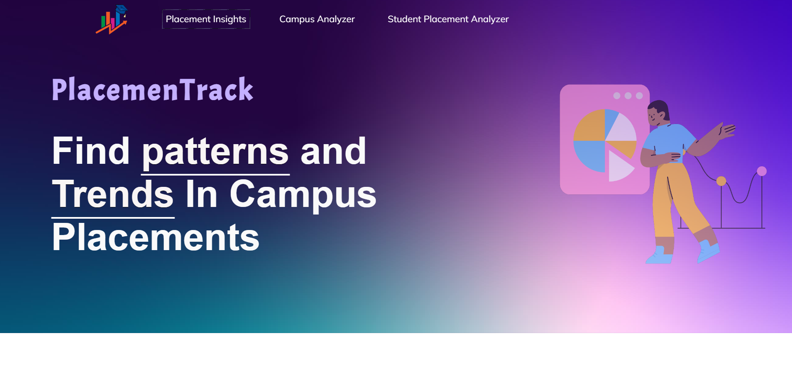
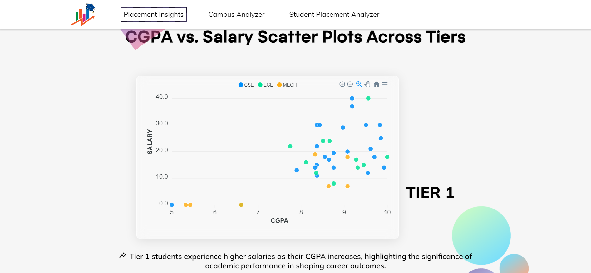
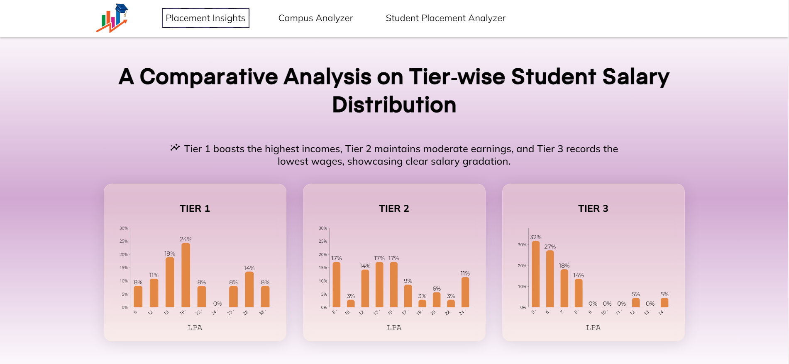
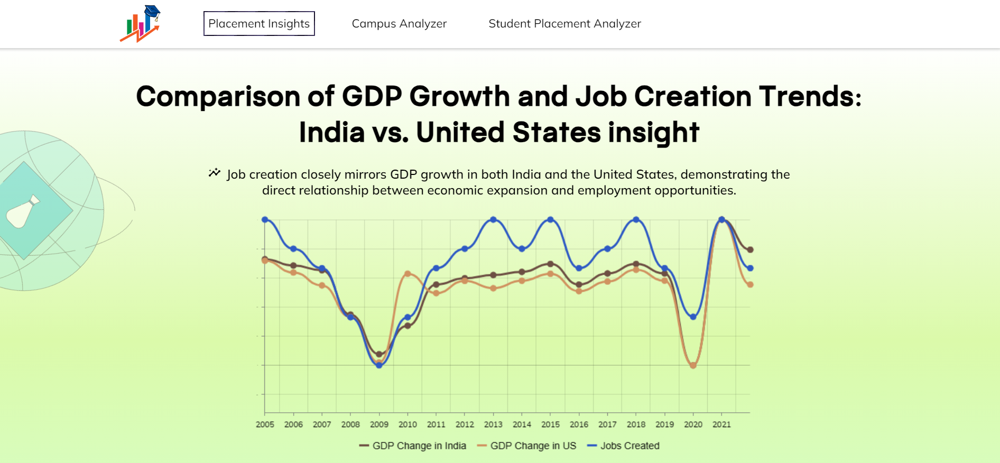
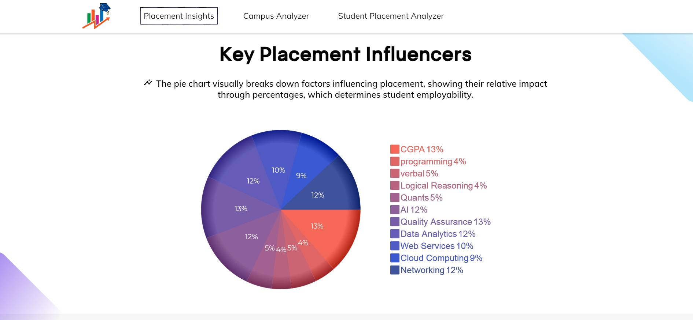
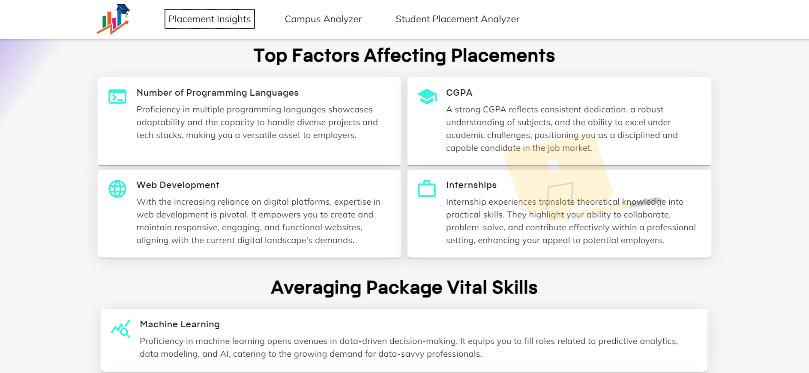

### Campus placement analyzer
Predicts placement results for an uploaded batch using the ML models.

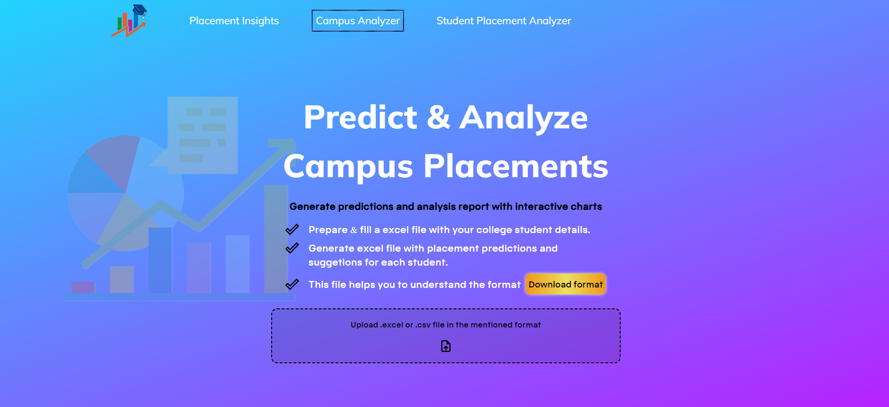
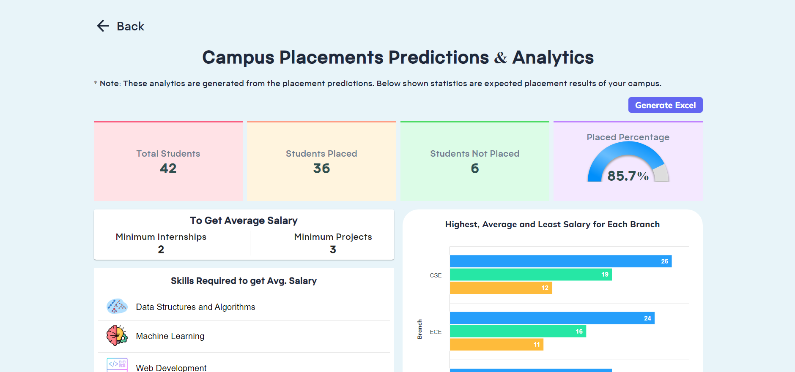
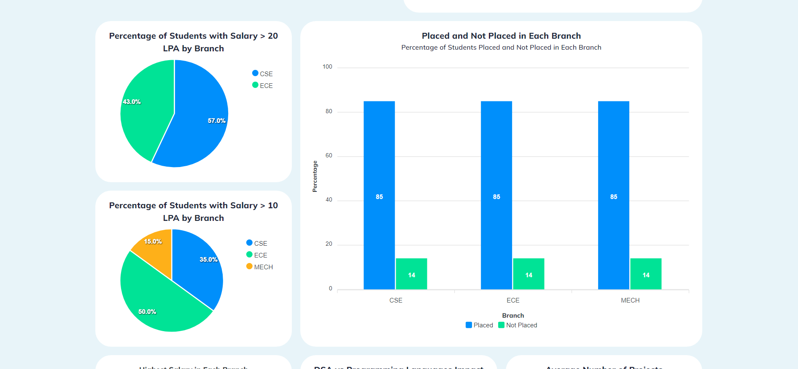
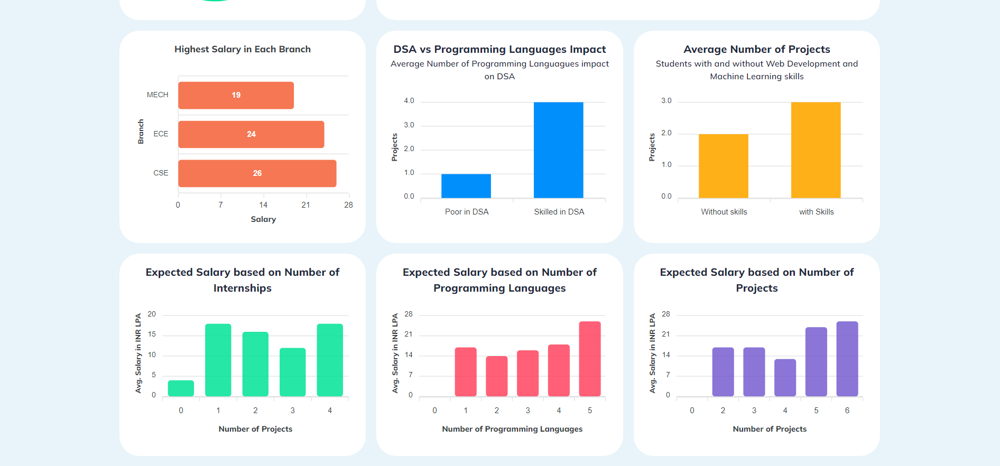

### Student placement prediction
Predicts a student's chance of placement and expected salary from their resume.

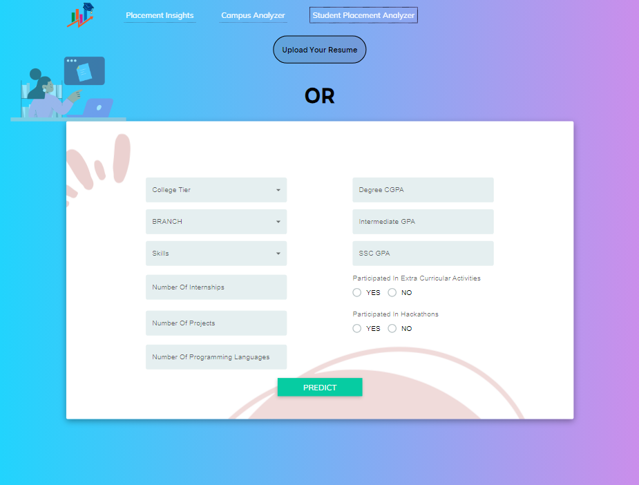
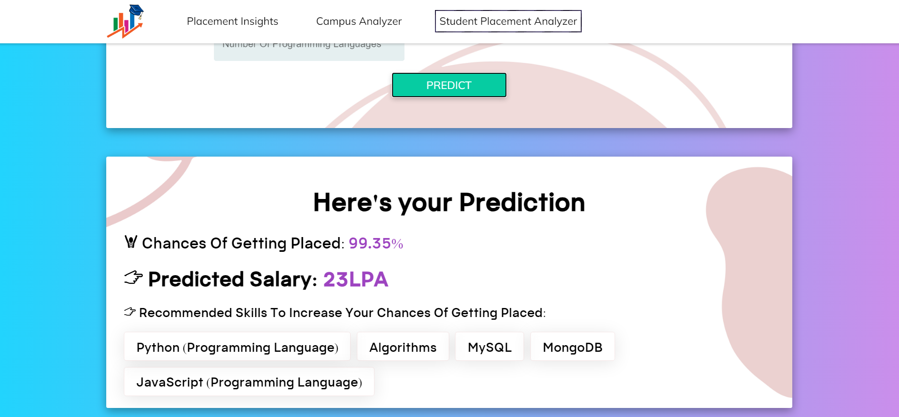

## Block diagram


## Flow chart


## Folder structure

```
careercompass/
├─ frontend          React application
├─ backend           Flask application and ML models
├─ EDA_Notebooks     EDA notebooks and datasets
│  ├─ datasets/
│  ├─ Campus_Placements_Insights.ipynb
│  ├─ Salary_Prediction.ipynb
│  ├─ Placement_prediction.ipynb
│  ├─ GDP_VS_Placements_EDA.ipynb
├─ project reports   Block diagram, flow chart and project report
├─ screenshots       App screenshots
├─ .gitignore
```

## Running locally

Clone the repo.

### Frontend

```
cd frontend
npm install
npm run dev
```

Node.js is required. Create `frontend/.env.local` with:

```
VITE_BACKEND_URL=http://localhost:5000
```

### Backend

```
cd backend
pip install -r requirements.txt
flask run
```

Python 3.9+ is recommended. Create `backend/.env` with these variables:

```
ML_DEPLOYMENT_API_KEY=
RESUME_PARSER_API=
RECOMMEND_SKILLS_API=
```

The app runs at http://localhost:3000 in development mode.

## Credits

Based on [campus-placement-analysis](https://github.com/partheev/campus-placement-analysis) by [partheev](https://github.com/partheev).
